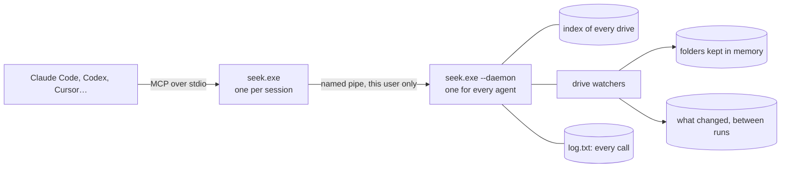

<p align="center"></p>

<h1 align="center">Seek</h1>

<p align="center"><strong>Fast file search for AI agents on Windows, as an MCP server.</strong><br>
Every drive in milliseconds, text in folders faster than ripgrep and fff, and answers in hundreds of tokens instead of hundreds of thousands.</p>

<p align="center">
<a href="https://seek.synrgs.tech"><b>Website and full benchmarks</b></a> ·
<a href="#install">Install</a> ·
<a href="https://github.com/SynrgStudio/seek/releases">Releases</a> ·
<a href="CHANGELOG.md">Changelog</a>
</p>

<p align="center">
<a href="https://github.com/SynrgStudio/seek/actions/workflows/build.yml"></a>
<a href="https://github.com/SynrgStudio/seek/releases/latest"></a>
<a href="LICENSE"></a>
</p>

---

Coding agents spend a surprising part of their time looking for files, with tools made for people. A recursive `dir` of a user profile takes a minute and a half. Listing every `.blend` file on a PC is about 196,000 tokens of context. And "the file I was working on" means nothing to a shell.

Seek gives the agent four tools that answer those questions directly:

| tool | what it does |
|---|---|
| **`find`** | Files and folders by name on every fixed drive, from an index, in milliseconds. Typo-tolerant, and ranked by what the user changed lately and the folders they use. `summary` gives counts by area instead of a list. |
| **`grep`** | Text inside the files of a folder, and inside its PDF and Office documents. Follows `.gitignore`. After a folder's first search, it is kept in memory and kept current by the drive watchers. |
| **`recent`** | What the user created, changed and opened lately, without the logs and caches programs write all the time. |
| **`sizes`** | What takes up the space below a folder or on a whole drive: the biggest folders a few levels down, and the biggest files. It reads the disk on several threads, so a whole SSD takes seconds. |

One background process serves every agent on the PC. It keeps the index, watches the drives, and remembers what changed. Seek only reads, never looks in private places such as keys, browser profiles or password managers, and logs every call for the user to see.

## Measured

On one PC with 4.9 million files and folders on three drives, against what an agent would use otherwise. Times are medians, and every tool was warm. [The website](https://seek.synrgs.tech#method) has the method, every table, and the raw numbers.

| task | Seek | the others |
|---|---|---|
| find a file by name, place unknown | **52 ms** | Everything 93 ms; fd 4.7 s with the folders in memory, over 15 min from disk; `dir /s` 85 s over one profile |
| the same, with a typo | **57 ms**, found | Everything, fd, ripgrep: not found |
| how many `.blend` files, and where | **55 ms**, 378 tokens | Everything's list: 196,438 tokens |
| text in every project, 10,700 files | **11 ms** | fff 36 ms; ripgrep 487 ms |
| text in one repository | **0.40 ms** | fff 0.61 ms; git grep 35 ms; ripgrep 29 ms |
| a name in one repository | **0.33 ms** | fff 0.43 ms |

For text, Seek's first search of a folder reads it from the drive: 132 ms for every project, which is already faster than ripgrep. The times in the table are the searches after that, answered from memory.

## Install

In PowerShell:

```powershell
irm https://raw.githubusercontent.com/SynrgStudio/seek/main/install.ps1 | iex
```

The installer:

- downloads `seek.exe` from the latest release into `%LOCALAPPDATA%\Programs\Seek`;
- checks it against the release's SHA-256;
- puts that folder on your PATH, so `seek --status` works in a console;
- adds it to **Claude Code** and **Codex** when they are installed.

Running it again updates Seek, with agent sessions open too: they get the new version from their next call.

Installed before 0.3.3, or by hand? This puts Seek's folder on your PATH, so `seek --status` and `seek --version` work in a console. It leaves the rest of your PATH as it is and does nothing if the folder is there already:

```powershell
$d = "$env:LOCALAPPDATA\Programs\Seek"
$k = [Microsoft.Win32.Registry]::CurrentUser.OpenSubKey('Environment', $true)
$p = $k.GetValue('Path', '', 'DoNotExpandEnvironmentNames')
if (-not ($p -split ';' | Where-Object { [Environment]::ExpandEnvironmentVariables($_).TrimEnd('\') -ieq $d })) {
    $kind = if ($k.GetValueNames() -contains 'Path') { $k.GetValueKind('Path') } else { 'ExpandString' }
    $k.SetValue('Path', ((@($p -split ';' | Where-Object { $_ }) + $d) -join ';'), $kind)
    [Environment]::SetEnvironmentVariable('SEEK_PATH', '1', 'User'); [Environment]::SetEnvironmentVariable('SEEK_PATH', $null, 'User')
}
$k.Close(); $env:Path += ";$d"
```

For any other MCP client, such as Cursor, Cline or Claude Desktop, add a stdio server whose command is the full path to `seek.exe`, with no arguments:

```json
{ "mcpServers": { "seek": { "command": "C:\\Users\\me\\AppData\\Local\\Programs\\Seek\\seek.exe" } } }
```

A line in the project's `CLAUDE.md` or `AGENTS.md` helps the agent reach for it:

```
To find files by name anywhere on this PC, or search text in a folder, use the seek tools (find, grep, recent, sizes) instead of shell commands.
```

## How it works



- **The index.** With [Jolt](https://github.com/SynrgStudio/jolt) installed, Seek copies the index Jolt builds from the drive's file table. Without it, Seek walks each drive itself on 8 threads, with no special rights, and walks them again once a day. On the PC above, that took 18 s for 2 million names on an SSD. The drive watchers cover what changes in between.
- **The search.**
  - Names go through Jolt's fuzzy matching on 8 threads.
  - Text search lists folders and reads files on 12 threads.
  - Binaries are recognized from their first 8 KB.
  - A file's bytes are checked for the pattern before any text is decoded, starting from the pattern's rarest character with `memchr`.
- **Folders in memory.** After a folder's first search, its text files are kept in memory, up to 512 MB in all.
  - A changed file is read again on the next search, new files are added, and deleted ones dropped.
  - A changed `.gitignore` makes the folder be read again.
  - A folder nobody searched for 20 minutes is let go.
- **The process.** Every session's `seek.exe` hands its calls to one background process through a named pipe that only the same user on the same machine can open, each call on a connection of its own, so the calls an agent sends at once run at once. A process from an older build makes way for a newer one, and serves the sessions of older ones. `seek --status` says how it is.

The website explains each part in depth, with the measurements behind every design choice: [seek.synrgs.tech](https://seek.synrgs.tech).

## Settings

`%APPDATA%\Seek\seek.txt`:

```
exclude = C:\Users\me\Private      a folder
exclude = *.key                     files with that extension
exclude = secrets                   any folder or file with that name
log = no                            don't write log.txt
cache = 256                         MB of folders kept in memory; 0 for none
jolt = no                           don't use Jolt's index or what Jolt knows
```

Seek's own files are in `%LOCALAPPDATA%\Seek`: its copies of the index, `activity.txt` with what it saw change, and `log.txt` with every call.

## Command line

```
seek --cli find "{\"query\":\"report .pdf\"}"      run a tool in this process
seek --call grep "{\"pattern\":\"TODO\",\"path\":\"C:\\\\code\"}"   through the background process
seek --reindex                                      walk the drives again now
seek --status                                       how the background process is: indexes, watchers, folders in memory
seek --stats                                        what agents asked, by day: calls, times, what found nothing
seek --stop                                         stop the background process
```

## For programs

Any program of the same user can ask Seek's background process directly, without MCP: a search box, an editor, a script. It sends JSON through Seek's named pipe and gets rows back, from the same index and history the agents use. Per request that costs about 0.1 ms; the search itself takes the 20–50 ms measured above.

```json
{"api": 1, "build": "0.0.0 myapp", "tool": "find.rows", "args": {"query": "report .pdf", "max": 5000}}
```

| command | what it gives |
|---|---|
| `find.rows` | files and folders by name, best first |
| `grep.rows` | the matching lines below a folder: path, line, column, text |
| `recent.rows` | what was created, changed, renamed or opened lately, with the time |
| `status.rows` | each drive's index: loading, being made (with the names so far), ready |
| `opened` | tells Seek a program opened a file, so it ranks as used |
| `hello`, `stop` | what is running; make room for a newer Seek |

[PROTOCOL.md](PROTOCOL.md) has the whole protocol: the messages, every command's arguments and rows, the error codes, how a program starts Seek (or a copy of its own), and what version 1 promises to keep. Seek's own search window and [Slate](https://github.com/SynrgStudio/slate) are built on it. Client packages for Rust, Python and npm are on the [roadmap](https://github.com/SynrgStudio/seek/issues/27).

## Building and testing

With Visual Studio and its C++ tools:

```
build.bat                         build\seek.exe
python -I tests\test.py           about 140 checks, in %TEMP%, with a background process of their own
python -I bench\bench.py          the comparison, against whatever tools it finds
```

Releases are built and tested on the maintainer's PC from the tagged commit, and published with their SHA-256. GitHub Actions builds every push and runs the tests there too.

## Limits

- **Windows only, fixed drives.** Network shares and other drives can still be searched by giving their folder as `path`: they are walked instead.
- **`regex` is slower than ripgrep's.** It uses the C++ standard library's engine, which is correct but much slower, and it looks at the first 4,096 characters of very long lines.
- **The first index takes a while without Jolt** on a big drive, longer on a hard disk. Searches below a folder work right away meanwhile, by walking it.
- **`recent` knows what changed while Seek was running,** plus what the drives' change journals still held when it started (hours of changes on a busy drive, days on a quiet one), and the dates on disk when given a `path`.

## License

GPL-3.0, like [Jolt](https://github.com/SynrgStudio/jolt), whose fuzzy matching and index format Seek shares.
